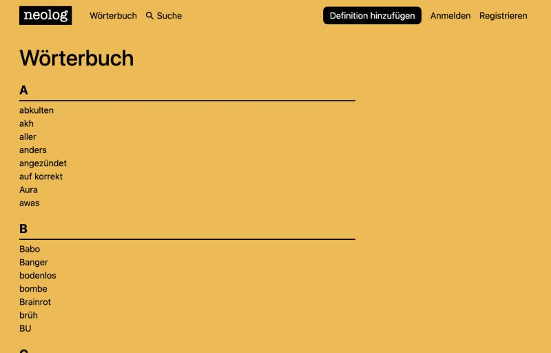
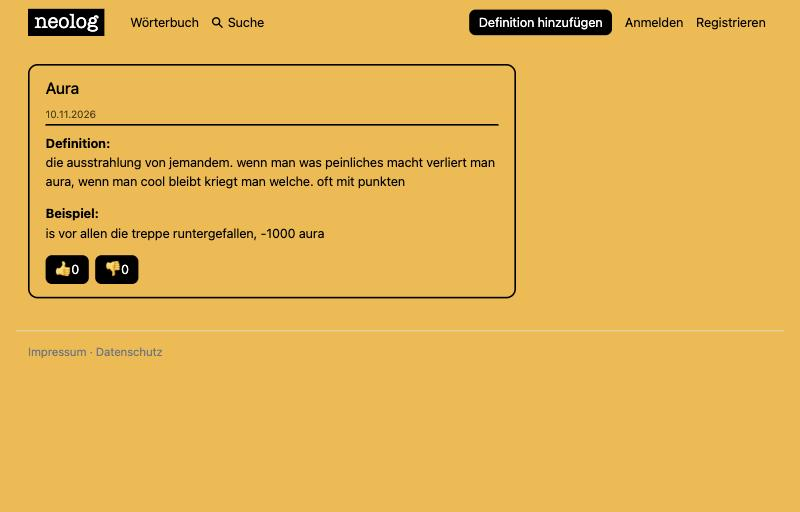
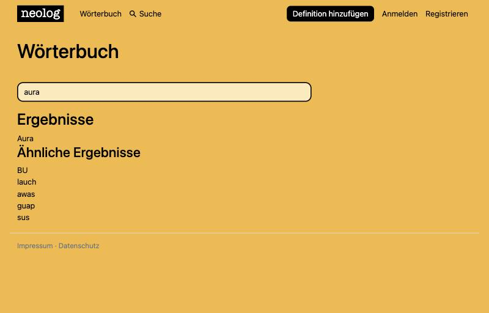

# neolog

Öffentliches Online-Wörterbuch, um Ausdrücke zu erklären, dokumentieren und den Wandel der Sprache festzuhalten.

Informationen und Dokumentation zum Projekt/ Django: https://github.com/Jonas-089/neolog/blob/master/Informationen

## Screenshots

| Alle Wörter | Ein Wort | Suche |
|---|---|---|
|  |  |  |


## Lokal starten

```bash
python3.12 -m venv .venv && source .venv/bin/activate
pip install -r requirements.txt
python manage.py migrate
python manage.py runserver
```

Ohne Umgebungsvariablen läuft die Seite im Debug-Modus mit SQLite (`db.sqlite3`).

## Deployment (z. B. Render)

- Build Command: `./build.sh`, Start Command: `gunicorn neolog.wsgi`
- Umgebungsvariablen: `DJANGO_SECRET_KEY`, `DATABASE_URL` (Postgres), optional `DJANGO_ALLOWED_HOSTS`, `EMAIL_HOST_PASSWORD`, `EMAIL_HOST_USER`
